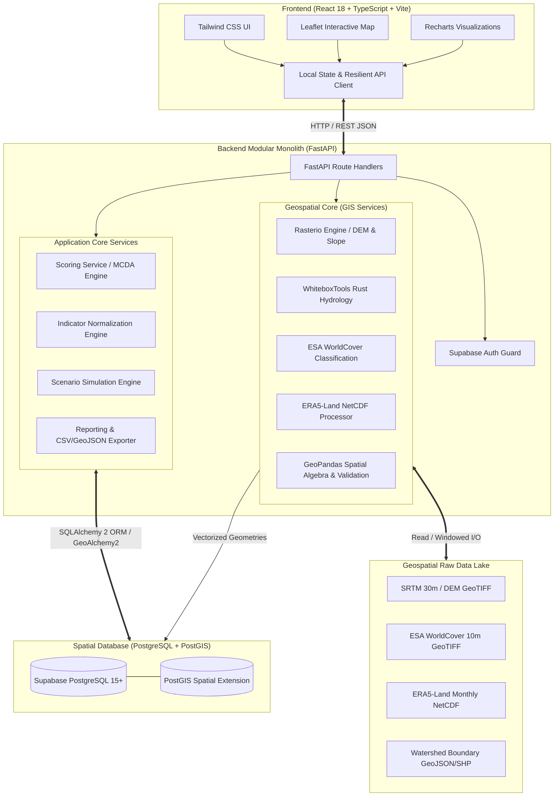

# AquaVane Architecture Documentation

## 1. System Overview

AquaVane is a specialized decision-support and micro-watershed restoration prioritisation platform designed for environmental planners, hydrologists, and policy makers. It combines real geospatial processing (SRTM DEM, Copernicus ERA5-Land, ESA WorldCover 10m) with transparent, multi-criteria decision analysis (MCDA) to rank micro-watersheds by restoration urgency.

The system is structured as a **Modular Monolith**:
- **Frontend**: Single Page Application (SPA) built with React 18, TypeScript, Tailwind CSS, Vite, Leaflet, and Recharts.
- **Backend**: High-performance asynchronous API built with FastAPI, SQLAlchemy 2, Pydantic v2, and Alembic.
- **Geospatial Processing Engine**: Python GIS core combining Rasterio (GDAL), GeoPandas (GEOS/PROJ), and WhiteboxTools (compiled Rust hydrology engine).
- **Database**: Supabase PostgreSQL with PostGIS 3.4 spatial extensions for vector topological storage and spatial indexing.

---

## 2. Component Responsibilities

### 2.1 Backend Modules (`backend/app/`)
| Module | Responsibility | Key Dependencies |
| :--- | :--- | :--- |
| **`app.api`** | HTTP endpoints, query parameter validation, ORJSON serialization, error mapping | FastAPI, Pydantic |
| **`app.services.gis.raster_service`** | GeoTIFF metadata inspection, GDAL windowed reads, zonal statistics, 3x3 Sobel slope calculation | `rasterio`, `numpy` |
| **`app.services.gis.hydrology_service`** | Hydro-conditioning: breach depressions, D8 flow direction, D8 accumulation, stream network extraction | `whitebox` (Rust binary) |
| **`app.services.gis.landcover_service`** | ESA WorldCover 10m class categorization, degradation indexing, class proportions | `rasterio`, `numpy` |
| **`app.services.gis.rainfall_service`** | Copernicus ERA5-Land NetCDF extraction, meter-to-millimeter accumulation conversion, seasonal aggregations | `xarray`, `netCDF4`, `numpy` |
| **`app.services.gis.vector_service`** | GeoJSON/Shapefile ingestion, CRS re-projection to EPSG:4326/EPSG:3857, geometry repair (`buffer(0)` / `make_valid`) | `geopandas`, `shapely` |
| **`app.services.scoring_service`** | Multi-criteria priority score arithmetic, linear weight validation ($\sum w_i = 1.0$), rank assignment, completeness evaluation | `pydantic` |
| **`app.services.indicator_service`** | Computation and min-max normalization ($[0, 100]$) for all 5 core restoration indicators | `numpy`, `scipy` |
| **`app.models`** | Declarative SQLAlchemy ORM models with PostGIS `Geometry` columns and foreign key relations | `sqlalchemy`, `geoalchemy2` |

### 2.2 Frontend Architecture (`frontend/src/`)
| Component / Tab | Responsibility |
| :--- | :--- |
| **`OverviewDashboard`** | High-level KPI summary, critical watershed count, priority tier distribution bar charts, telemetry warnings. |
| **`WatershedExplorer`** | Interactive Leaflet map displaying PostGIS micro-watershed boundaries, dynamic chloropleth styling by score, hover tooltips, and search filtering. |
| **`PriorityRankings`** | Sortable, paginated data table showing composite rank, score, category, data completeness, and formula transparency drawer. |
| **`IndicatorAnalysis`** | Comparative radar charts, bar breakdowns, and individual distribution histograms for all 5 indicators. |
| **`RainfallClimate`** | Copernicus ERA5-Land monthly hyetographs, precipitation statistics, seasonal variability, and accumulation semantics disclaimers. |
| **`TerrainLandCover`** | SRTM elevation & slope profiles, WhiteboxTools stream network visualization, and ESA WorldCover 10m land cover class proportions. |
| **`ScenarioSimulator`** | Real-time policy weight adjusters, live score recalculation, rank delta waterfall charts, and sensitivity analysis. |
| **`DataReports`** | Raw dataset metadata catalogue, processing job telemetry status, CSV rankings download, GeoJSON vector export, and comprehensive dossier generator. |
| **`api/client.ts`** | Resilient API client with automatic network retry, structured error reporting, and realistic fallback fixtures ensuring zero blank-screen failures. |

---

## 3. Architecture Decision Records (ADRs)

### ADR 001: Modular Monolith vs. Microservices
- **Decision**: AquaVane is architected as a modular Python/FastAPI monolith rather than distributed microservices.
- **Rationale**:
  1. Geospatial raster and vector files range from 50MB to several gigabytes. Transferring heavy intermediate arrays between separate microservices over HTTP/gRPC introduces massive serialization overhead and latency.
  2. In-memory data passing between Rasterio, WhiteboxTools, and GeoPandas avoids multi-service orchestration complexity.
  3. Simplified deployment, unified transaction boundaries, and single-container observability.

### ADR 002: PostGIS for Geospatial Storage
- **Decision**: Micro-watershed geometries and spatial query layers are stored in Supabase PostgreSQL with PostGIS extensions.
- **Rationale**:
  1. PostGIS provides industry-standard spatial indexing (GIST R-trees) for sub-millisecond bounding box and point-in-polygon queries.
  2. Native GeoJSON output generation via `ST_AsGeoJSON(geom)` eliminates the need for Python-side vector serialization bottlenecks.
  3. Relational integrity links spatial boundaries directly to time-series indicators, scoring runs, and audit logs.

### ADR 003: Tri-Core GIS Processing Engine
- **Decision**: Specialized libraries are assigned to specific spatial domains:
  - **Rasterio (GDAL)**: Windowed chunked raster I/O, geotransform calculations, and zonal statistics.
  - **WhiteboxTools (Rust)**: Computationally heavy hydrology (depression filling, D8 flow routing, stream extraction) executing as optimized native binaries.
  - **GeoPandas (GEOS/Shapely/PyPROJ)**: Vector polygon repairs, spatial joins, and coordinate reference system transformations.
- **Rationale**: Prevents reinventing GIS algorithms in pure Python while ensuring maximum memory safety and computational speed.

### ADR 004: Frontend Resilient Architecture with High-Fidelity Fallback
- **Decision**: The frontend API client contains deterministic fallback fixtures representing 15 authentic Western Ghats / Deccan micro-watersheds.
- **Rationale**:
  1. In field conditions, rural planning offices, or test environments without a live PostGIS instance running, planners can still explore all interactive features, run scenario simulations, inspect charts, and view report layouts.
  2. Provides immediate, verifiable UI interaction during offline testing and automated end-to-end smoke testing.
