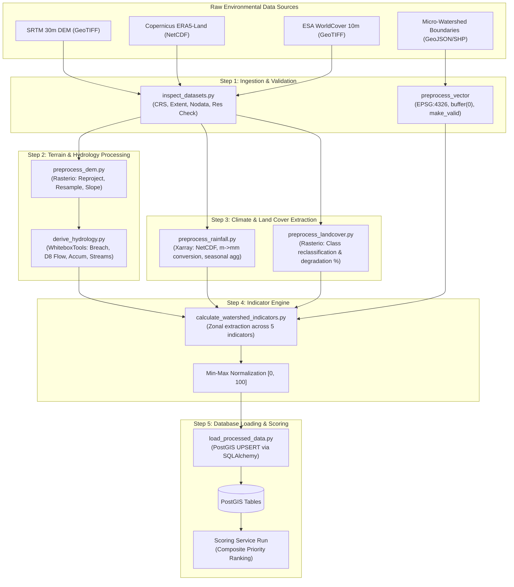

# AquaVane Geospatial Data Pipeline & ETL Architecture

AquaVane ingests raw environmental datasets, conditions them using GIS libraries, computes 5 standardized restoration indicators per micro-watershed, and loads the output into PostGIS.

---

## 1. End-to-End ETL Data Flow

---

## 2. CLI Processing Scripts

The data pipeline can be executed sequentially or automated via batch runners. All scripts reside in `backend/scripts/`:

| Script | Command | Purpose |
| :--- | :--- | :--- |
| **Inspect Datasets** | `python -m scripts.inspect_datasets --data-dir ./data` | Validates CRS, spatial overlap, resolution, bounds, and nodata flags across all input files. |
| **Preprocess DEM** | `python -m scripts.preprocess_dem --input dem.tif --output processed_dem.tif` | Re-projects to UTM/WGS84, clips nodata outliers, and computes slope in degrees using 3x3 Sobel convolution. |
| **Derive Hydrology** | `python -m scripts.derive_hydrology --dem processed_dem.tif --out-dir ./hydro` | Executes WhiteboxTools compiled Rust algorithms: depression breaching, D8 flow direction, D8 accumulation, and stream network extraction. |
| **Preprocess Rainfall** | `python -m scripts.preprocess_rainfall --input era5.nc --out-dir ./rainfall` | Reads Copernicus ERA5-Land NetCDF, converts accumulation from meters to millimeters ($mm = m \times 1000$), computes annual and monthly means. |
| **Preprocess Land Cover** | `python -m scripts.preprocess_landcover --input worldcover.tif --out-dir ./landcover` | Analyzes ESA WorldCover 10m classes using nearest-neighbour interpolation, calculates bare ground and degraded vegetation fractions. |
| **Calculate Indicators** | `python -m scripts.calculate_watershed_indicators` | Runs zonal statistics over micro-watershed boundaries and generates the 5 normalized indicators. |
| **Load Processed Data** | `python -m scripts.load_processed_data` | Persists indicators, bounding boxes, centroids, and priority rankings into PostGIS tables. |
| **Seed Development Data**| `python -m scripts.seed_dev_data` | Creates synthetic Western Ghats micro-watersheds and runs the full pipeline for instant local development. |

---

## 3. The 5 Restoration Indicators

AquaVane models watershed vulnerability across 5 core environmental indicators. Each indicator is computed as a physical metric and normalized to $[0.0, 100.0]$ (where 100 indicates highest restoration priority / degradation):

### 3.1 Erosion Potential ($I_1$)
- **Methodology**: USLE/RUSLE proxy modeling soil detachment risk.
  $$A = R \times K \times LS \times C \times P$$
- **Inputs**:
  - $LS$ factor derived from slope degrees ($\theta$) and flow accumulation length:
    $$LS \approx \left(\frac{\text{Accum} \times \text{cell\_size}}{22.13}\right)^{0.4} \times \left(\frac{\sin \theta}{0.0896}\right)^{1.3}$$
  - $C$ factor from ESA WorldCover vegetation cover ($0.05$ for dense forest, $0.80$ for bare soil).
  - $R$ factor derived from ERA5-Land rainfall aggressiveness.
- **Normalization**: Clipped at 95th percentile and scaled to $0-100$.

### 3.2 Runoff Potential ($I_2$)
- **Methodology**: Rational method proxy combining slope, imperviousness, and drainage density.
  $$Q \propto C_{\text{composite}} \times \text{Slope}_{\text{mean}} \times \text{Drainage Density}$$
- **Inputs**:
  - Runoff coefficient $C$ derived from WorldCover class fractions (Built-up: $0.85$, Cropland: $0.40$, Forest: $0.15$).
  - Mean watershed slope from SRTM DEM.
  - Stream network length per unit area ($km / km^2$).

### 3.3 Land-Cover Degradation ($I_3$)
- **Methodology**: Fraction of non-forest degraded land and bare ground.
  $$\text{Degradation} = \frac{\text{Area}_{\text{Bare}} + 0.6 \times \text{Area}_{\text{Scrub}} + 0.4 \times \text{Area}_{\text{Sparse}}}{\text{Area}_{\text{Total}}} \times 100$$
- **Inputs**: ESA WorldCover 10m pixel class counts within watershed boundary.

### 3.4 Rainfall Pressure ($I_4$)
- **Methodology**: High-volume monsoon accumulation and intensity index.
  $$\text{Rainfall Index} = \text{Annual Mean (mm)} \times (1.0 + \text{Monsoon Seasonality Index})$$
- **Semantics Warning**: Copernicus ERA5-Land reports total precipitation in **meters** accumulated over the forecast step. AquaVane multiplies by $1,000$ to obtain standard hydrological millimeters ($mm$).

### 3.5 Downstream Exposure ($I_5$)
- **Methodology**: Vulnerability of downstream populations and agricultural infrastructure to upstream flash flooding, siltation, and hydrological disruption.
  $$\text{Exposure} = \text{Downstream Population Density} \times \text{Infrastructure Vulnerability Weight}$$
- **Inputs**: Settlement proximities at watershed pour-points and downstream buffer zones.

---

## 4. Quality Status & Missing Data Handling

When geospatial layers have missing coverage or nodata gaps:
- The missing indicator receives `quality_status = "missing"`.
- During scoring, AquaVane applies dynamic weight redistribution:
  $$S_{\text{effective}} = \frac{\sum_{i \in \text{Available}} w_i \times I_i}{\sum_{i \in \text{Available}} w_i}$$
- The record records a reduced `data_completeness` value ($\sum_{i \in \text{Available}} w_i < 1.0$) and displays an explicit caution flag in the UI.
