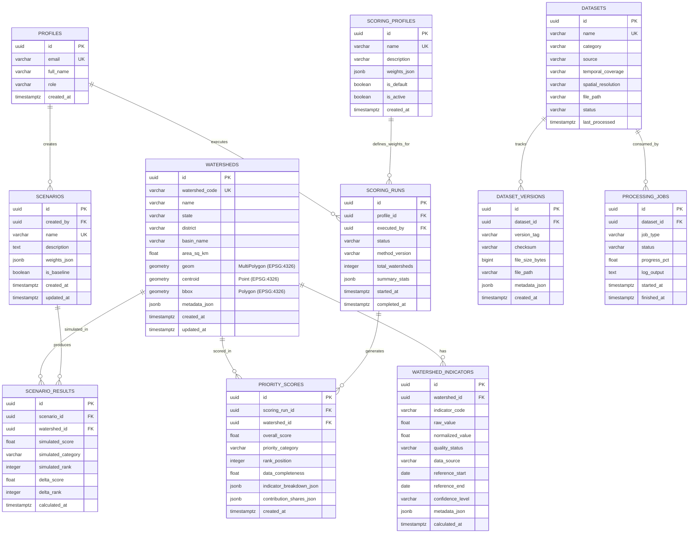

# AquaVane Database Schema & Spatial Architecture

AquaVane uses a relational PostgreSQL 15+ database with the PostGIS 3.4 spatial extension (hosted on Supabase or locally). All tables use UUID primary keys for distributed safety and auditability.

---

## 1. Entity-Relationship Diagram (ERD)



---

## 2. Table Specifications

### 2.1 `watersheds`
Stores geographical micro-watershed boundaries, bounding boxes, centroids, and regional identifiers.
- **`geom`**: `Geometry('MULTIPOLYGON', srid=4326)` - PostGIS boundary geometry.
- **`centroid`**: `Geometry('POINT', srid=4326)` - Computed geographic center for fast map marker placement.
- **`bbox`**: `Geometry('POLYGON', srid=4326)` - Envelope polygon for sub-second spatial intersection queries.
- **Spatial Index**: `CREATE INDEX idx_watersheds_geom ON watersheds USING GIST (geom);`

### 2.2 `watershed_indicators`
Stores computed and normalized indicator values for each micro-watershed.
- **`indicator_code`**: One of `erosion_potential`, `runoff_potential`, `landcover_degradation`, `rainfall_pressure`, `downstream_exposure`.
- **`raw_value`**: Physical engineering dimension (e.g., $t/ha/yr$, runoff coefficient $C$, degraded area $\%$, annual $mm$, population density).
- **`normalized_value`**: Scaled $0.0 - 100.0$ value used directly in weighted scoring.
- **`quality_status`**: `computed` (directly derived), `imputed` (neighbor-inferred), `missing` (no data available), `stale` (outdated source).
- **Index**: Unique composite index on `(watershed_id, indicator_code)`.

### 2.3 `scoring_profiles` & `scoring_runs`
Maintains auditable history of prioritisation algorithms and weightings.
- **`weights_json`**: Key-value JSON document enforcing $\sum w_i = 1.0 \pm 0.001$.
- **`scoring_runs`**: Immutable audit record of every prioritisation execution, recording the execution timestamp, runtime, total watersheds evaluated, and statistical distribution.

### 2.4 `priority_scores`
Individual micro-watershed scores produced by a specific scoring run.
- **`overall_score`**: $\sum_{i=1}^5 (w_i \times I_i)$ constrained to $[0.0, 100.0]$.
- **`priority_category`**:
  - `critical`: Score $\ge 75.0$
  - `high`: $60.0 \le \text{Score} < 75.0$
  - `medium`: $40.0 \le \text{Score} < 60.0$
  - `low`: Score $< 40.0$
- **`data_completeness`**: Ratio of non-missing indicator weights to total weight.
- **Index**: Composite index on `(scoring_run_id, rank_position)` for sub-millisecond leaderboard retrieval.

### 2.5 `scenarios` & `scenario_results`
Enables exploratory policy simulation without mutating production scoring runs.
- Planners can tweak weightings (e.g. prioritize erosion mitigation vs downstream protection).
- `scenario_results` stores `delta_score` and `delta_rank` relative to the baseline scoring run.

---

## 3. Spatial Queries & Indexing Strategy

AquaVane utilizes PostGIS native functions for maximum geospatial efficiency:
```sql
-- 1. Sub-second Bounding Box Viewport Queries
SELECT id, watershed_code, name, ST_AsGeoJSON(geom)
FROM watersheds
WHERE geom && ST_MakeEnvelope(:min_lon, :min_lat, :max_lon, :max_lat, 4326);

-- 2. Geometry Simplification for High-Zoom Levels
SELECT id, ST_AsGeoJSON(ST_SimplifyPreserveTopology(geom, 0.001))
FROM watersheds;

-- 3. Point-in-Watershed Identification
SELECT id, watershed_code, name
FROM watersheds
WHERE ST_Contains(geom, ST_SetSRID(ST_Point(:lon, :lat), 4326))
LIMIT 1;
```
