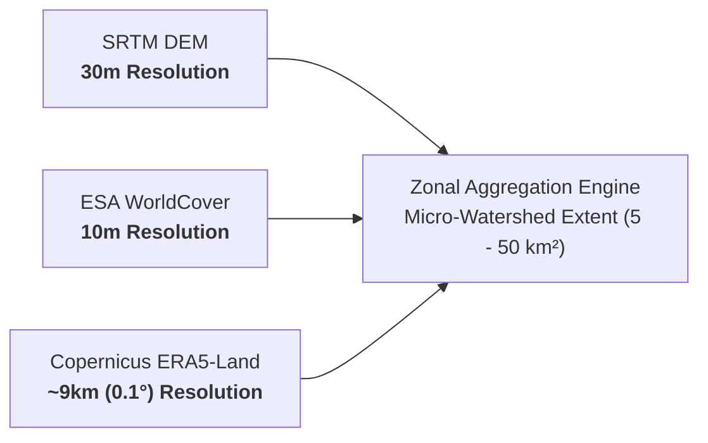

# AquaVane Methodological Limitations, Caveats & Disclaimers

> [!IMPORTANT]
> **Decision-Support Notice**: AquaVane is designed as a macro-to-meso scale screening and prioritisation tool. It is intended to guide resource allocation and target field reconnaissance, **not** to substitute for detailed on-ground civil engineering design or calibrated physical process modelling.

---

## 1. Screening Tool vs. Detailed Engineering Models

| Dimension | AquaVane Restoration Index | Calibrated Hydrodynamic / Sediment Models (SWAT / HEC-RAS) |
| :--- | :--- | :--- |
| **Primary Purpose** | Fast, comparative screening and regional prioritisation across hundreds of micro-watersheds. | Exact peak flow prediction, flood inundation mapping, and hydraulic structure design. |
| **Input Requirements** | Global satellite and reanalysis rasters (SRTM, WorldCover, ERA5-Land). | Local rainfall gauge networks, river bathymetry, calibrated soil moisture profiles, rating curves. |
| **Calibration** | Multi-criteria empirical normalization ($[0, 100]$). | Parameter optimization against measured streamflow and sediment gauge hydrographs. |
| **Usage Guidance** | **Use for selecting where to intervene.** | **Use for sizing check dams, contour trenches, and spillways.** |

---

## 2. Spatial Scale & Resolution Disparities

AquaVane harmonizes multi-source datasets with inherently different spatial and temporal resolutions:

### 2.1 The ERA5-Land Resolution Discrepancy
- Copernicus ERA5-Land has a native grid cell size of approximately **$9 \times 9\text{ km}$ ($0.1^\circ \approx 81\text{ km}^2$)**.
- Many micro-watersheds in India have areas between **$10\text{ km}^2$ and $45\text{ km}^2$**, meaning multiple micro-watersheds may fall within a single ERA5-Land grid cell.
- **Consequence**: Micro-climatic variation (such as orographic rainfall enhancement on western ridge slopes vs. leeward rain shadows) cannot be distinguished within the same ERA5 grid cell without local AWS/telemetry downscaling.

### 2.2 Modifiable Areal Unit Problem (MAUP)
- Indicators aggregated to micro-watershed administrative or hydrological boundaries are subject to MAUP. Boundary delineations derived from different DEM resolutions (e.g. SRTM 30m vs CartoDEM 10m vs LiDAR) can slightly alter boundary geometry, drainage area, and aggregated class proportions.

---

## 3. Data Latency and Product Caveats

### 3.1 Copernicus ERA5-Land Precipitation Semantics
- In ERA5-Land NetCDF archives, total precipitation is exported in **meters ($m$) of water equivalent** accumulated over the forecast step.
- While AquaVane automatically converts meters to millimeters ($mm = m \times 1000$), users inspecting raw NetCDF files or linking custom data pipelines must adhere to this accumulation convention to avoid a $1000\times$ calculation error.

### 3.2 ESA WorldCover Optical Misclassification
- ESA WorldCover 10m is derived from Sentinel-1 radar and Sentinel-2 optical imagery.
- In rugged mountainous terrain (e.g. Western Ghats), steep topography creates hill-shade radar shadows and cloud contamination that may misclassify sparse degraded scrub as closed-canopy forest or shadow water bodies.

---

## 4. Unmodeled Sociotechnical Factors

AquaVane focuses purely on biophysical terrain, hydrologic, and land cover vulnerability. The following critical restoration variables are **not modeled**:
1. **Land Tenure and Ownership**: Whether land is state forest, revenue land, or private farmland affects restoration feasibility.
2. **Groundwater Extraction Rates**: Intensive borewell extraction and deep aquifer depletion are not captured by surface DEM models.
3. **Existing Soil & Water Interventions**: Previously constructed check dams, percolation ponds, and farm bunds that already intercept runoff are not reflected in baseline DEMs unless re-surveyed.
4. **Community Institutional Capacity**: Village panchayat participation, user committees, and local stewardship readiness.

---

## 5. Protocols for Decision-Makers

Before committing capital expenditure based on AquaVane priority scores:
1. **Check Data Completeness**: Watersheds with `data_completeness < 0.8` should be treated with caution, as missing indicators trigger weight redistribution.
2. **Conduct Ground Verification**: Carry out field transect walks to confirm gullies, soil depth, and actual degradation status.
3. **Engage Local Communities**: Conduct Gram Sabha and stakeholder consultations to align technical recommendations with community needs.
